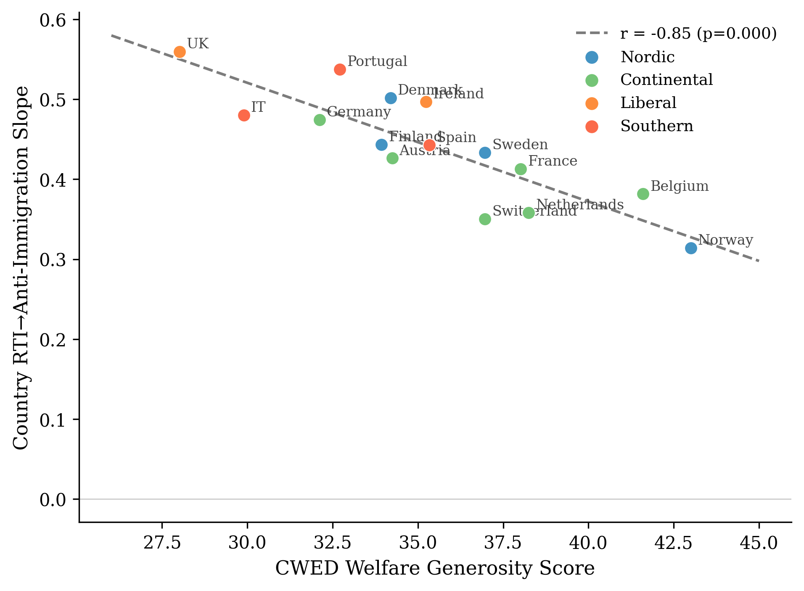

# Ben Smart — research portfolio

MSc Economics, University of Copenhagen (2026). I study how welfare institutions shape the political response to economic disruption — and what dignity-preserving welfare design can do about it.

This repository is a curated subset of my work: the pieces I would want read first. It is deliberately small. Each item is finished and stands on its own.

*Where welfare is more decommodifying, automation exposure converts into anti-immigration sentiment far less readily. Cross-national gradient from "Dignity Is a Baseline" (r = −0.855, N = 15).*

---

## 1. Dignity Is a Baseline — seminar paper

*Welfare Institutions and the Asymmetric Politics of Economic Disruption.* University of Copenhagen, Welfare State Seminar, Spring 2026.

Why does economic disruption so often produce the wrong politics — workers exposed to automation turning against immigrants rather than toward the welfare state? The standard answer treats welfare as a buffer and asks how much a country spends. This paper argues the buffering account measures the wrong thing. Welfare shapes the *direction* of the political response, not only its intensity, and it does so through what it communicates to vulnerable workers about their standing, not through how much it spends. Across the European Social Survey (rounds 6–9, 34 countries, N = 188,764), decommodification — not spending — is the dimension along which the politics of economic disruption becomes visible.

→ **[Read the paper](seminar-paper/)** — rendered in full, with figures; the formatted Word version is in the folder.

## 2. claimpin — reproducibility tooling

The numbers a paper asserts drift. A model is re-run, a table regenerated, and an old coefficient lingers in an earlier paragraph. `claimpin` pins every numeric claim in a manuscript to the artifact that grounds it, and fails loudly — in CI or before submission — when the prose and the ground truth diverge. A small, well-tested Python package (MIT) with a plugin system for paper-specific computations.

→ **[Browse claimpin](claimpin/)** — source, tests, and a runnable synthetic quickstart.

claimpin verifies all 99 numeric claims in the seminar paper above — see the parity report in case_studies/seminar_paper/.

## 3. Two faces of solidarity — a methods-and-integrity case study

Does automation exposure move the two faces of redistributive preference — *how much* (support for redistribution) and *for whom* (who is judged deserving) — together, or do they dissociate? A small confirmatory study built around a frozen analysis plan and a falsification audit answered against the data. The honest result is a *directional* dissociation: exposure reliably raises the amount of redistribution demanded, while its push on deservingness is weak and largely an education gradient. Two of the five pre-committed kill-conditions fired, and the writeup reports them as such — the conceded null is the point. Extends *Dignity Is a Baseline*.

→ **[Read the study](two-faces-of-solidarity/)** — frozen plan, falsification audit, and reproducible code (data restricted, not included).

## 4. chess-coach — personal chess coaching pipeline

A data pipeline that turns my chess.com games into interactive, engine-verified coaching reviews. Each game gets a narrative explanation of what went wrong, move-by-move Stockfish analysis, drag-and-try board exploration, and a validation pass that machine-checks every coaching claim against the engine lines. Python 3.14 · SQLite · Stockfish 17 · Claude · vanilla JS/CSS (no framework, no build step — each review is one self-contained HTML file).

→ **[See a sample review](chess-coach/)** — an interactive game review with coach bubbles, eval graph, and move-quality badges.

## 5. A dictation filter that rewrites instead of answering

→ **[Read the note](dictation-filter/)** - how a voice-dictation rewrite prompt stops a model answering the question it was meant to rewrite, and what each Claude model needed for that to hold.

---

## A note on data

The empirical work draws on the European Social Survey and related survey sources, which are governed by use agreements that restrict redistribution. No raw microdata is included here — only finished writing, derived figures, and code.

Built with Claude as a pair-programmer; the research design, analysis, and domain judgment are mine.

## License

Code (`claimpin/`, `chess-coach/`) is MIT-licensed. The seminar paper, its figures, and the written text in this repository are © 2026 Ben Smart, shared for review as part of a graduate-application portfolio and not licensed for reuse. See [LICENSE](LICENSE).
